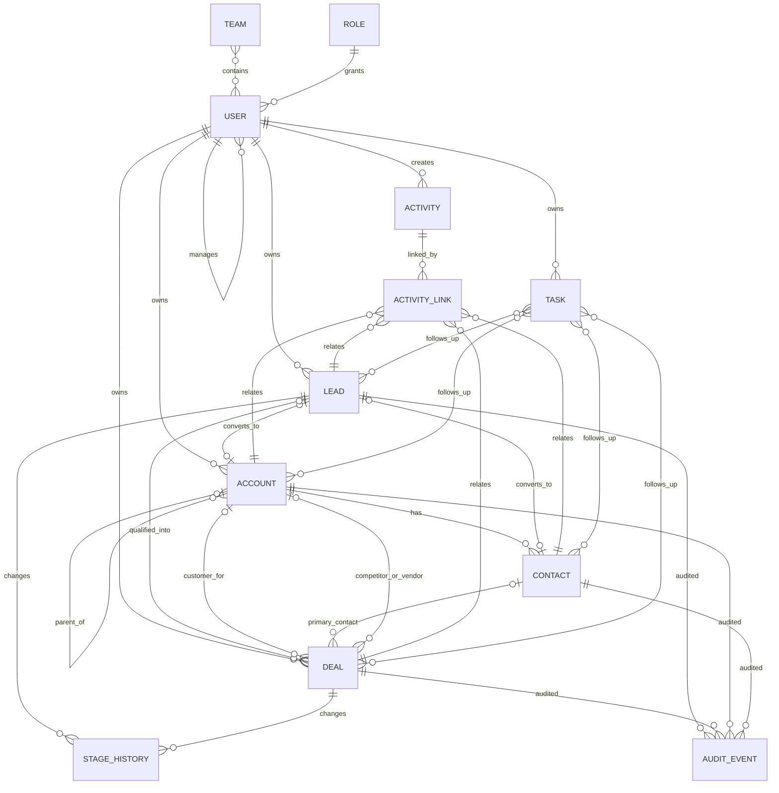
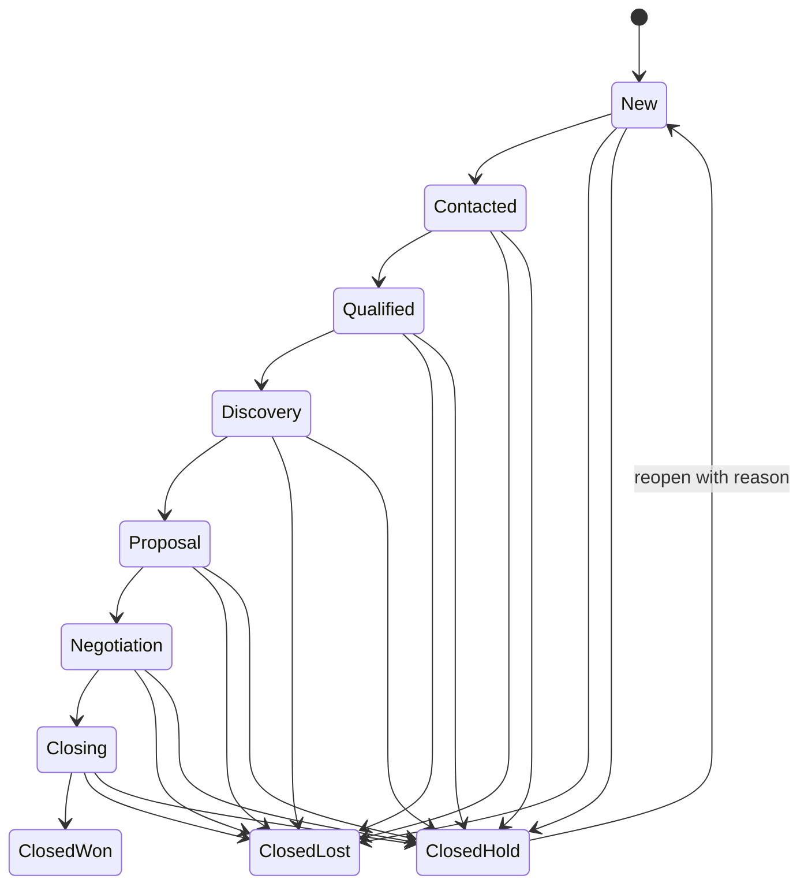

# Self-Hosted CRM Product Architecture and MVP Specification

**Selected stack:** Django 6.0, Django REST Framework, server-rendered Django templates + HTMX, Bootstrap 5, MySQL 8.4, Docker Compose.  
**Purpose:** A single sales workspace for a mid-sized IT consulting company, with a small Phase 1 that can grow to the stated 50 users and approximately 500,000 records without a rewrite.

## 1. Assumptions and open questions

### Decisions used in this design

| Topic | Design decision / default | Confirm before production |
|---|---|---|
| Company name | Company settings are editable; seed as **Example Consulting** until supplied. | Legal name, logo, address, industry, services/products. |
| Stack | Django 6.0 + DRF, HTMX templates, Bootstrap 5, MySQL 8.4. One deployable web app plus database; no separate frontend service. | None unless in-house skills favor another stack. |
| Company size | Use the new requirement of 50 users / 500k records for schema and query design. Earlier prompt said 10–15 users / ~2k records; the higher target takes precedence. | Expected activity/attachment volume and retention policy. |
| Currency | Default USD; Phase 1 requires deals to use the company base currency. Store an ISO currency code on every deal so multi-currency can be added safely. | Base currency and whether multiple currencies are needed in MVP. |
| Fiscal year | Default January 1; make start month configurable. | Fiscal year start month. |
| Time zones | Persist timestamps in UTC; render in each user’s configured IANA time zone. Default `America/Los_Angeles` for seed/dev only. | Company default time zone. |
| Qualification | MQL and SQL are operational statuses, not a claim that a lead is guaranteed ready. Keep qualification criteria configurable and record why the status changed. | Exact MQL/SQL criteria and whether Marketing owns MQL entry. |
| Conversion | Conversion is a lifecycle event, not another pipeline stage. Converted leads retain their final stage and history but leave active lead queues. | Whether converted lead records should remain visible to reps. |
| Record sharing | Owners see their records; managers see recursively assigned reports’ records; configured roles may see all records of permitted object types. No arbitrary per-record sharing in MVP. | Any exceptions to manager-tree visibility. |
| Customer data | Build with synthetic data first. Do not import production data until access checks, backups, and restore are reviewed. | Data classification, retention and deletion policy. |

### Open questions to resolve

1. What legal/company name, logo, address, industry, and product/service catalog should the initial settings contain?
2. What is the base currency, fiscal-year start month, and company time zone?
3. Which lead sources, industries, company-size bands, nurture reasons, disqualification reasons, and loss/hold reasons should be seeded?
4. Who may export each record type? Default below is manager/director/admin only for sensitive data.
5. Should managers see only direct reports or all descendants? This design defaults to all descendants.
6. Which Microsoft 365 licensing/tenant policy applies to Graph mail/calendar scopes and OneDrive? Phase 2 requires an Entra app registration and tenant consent.
7. Which fields are mandatory at each Deal stage? Defaults below are intentionally light and editable by Admin.

## 2. Module overview and delivery scope

| Module | Phase 1 MVP | Phase 2 |
|---|---|---|
| Leads | CRUD, ownership, source, qualification stages, sub-statuses, activity timeline, stale alerts, saved filters, Kanban, duplicate detection, conversion wizard, bulk assignment/update. | Scorecards and contextual scripts; optional lead-source integrations. |
| Accounts | Customer/prospect/partner/referral/competitor/vendor records, parent-child structure, owner, related contacts/deals/activities, duplicate checks. | Product/price book rollups; support/case context. |
| Contacts | Person record under an Account, primary contact, reports-to, communication preferences, related activity history. | Outlook contact sync only if explicitly required. |
| Deals | Lead-or-Account source, one of three deal types, stages, default probabilities, BANT, stage gates, temperature, forecast, close reasons, stage history. | Products/services and line items, quote generation, scorecards. |
| Activities and tasks | Calls, emails, meetings, notes, tasks, due-date reminders, quick logging, stale record alerts. | Outlook two-way calendar sync and appointment booking. |
| Administration | Company settings, users, reporting hierarchy, teams, roles, picklists, pipeline stages/probabilities, stage gates, stale thresholds. | Entra ID SSO and sales handbook administration. |
| Reports and dashboards | Rep, Manager and Executive dashboards; standard pipeline, conversion, forecast, activity and won/lost reports; filtered export. | Goals/OTE scorecards, weekly sales-call report, handbook guidance. |
| Import/export | XLSX and CSV templates, mapping, validation preview, duplicate policies, external-ID upsert, row errors, batch history and guarded rollback. | OneDrive integration may replace manual document-sharing workflows. |
| Cases | Out of scope. | Account/contact-linked support cases with status, priority, owner and SLA dates. |
| Sales Handbook | Out of scope. | Goals/KPIs, lead acquisition strategy, Infoshare Pyramid Sales Process, contextual scripts, Client Success collaboration, reporting guide and weekly status template. |
| Integrations | None required for core CRM. Local attachments and email/task logging. | Microsoft Graph for Outlook calendar and OneDrive; optional Entra SSO. |

## 3. Data model

### Conventions

- IDs are UUIDs. Every business record has a unique immutable `external_id` for imports and integrations.
- `created_at`, `updated_at` are UTC timestamps; `created_by_id`, `updated_by_id` reference User. Use optimistic locking (`version`) on records edited inline to prevent silent overwrites.
- Soft-deleted records have `deleted_at`, `deleted_by_id`, and `delete_reason`; normal queries exclude them. Admin-only restore is logged.
- Money is `Decimal(18,2)` plus ISO-4217 currency code. No floating-point arithmetic. MVP reporting uses base currency only.
- Fields marked “conditional” are required only for the stated stage/type/action. `?` means optional.
- `owner_id` is required for Lead, Account, Deal, Contact (inherited from Account by default), Activity, and Task.

### Core entities

| Entity | Fields (type; required unless `?`) | Relationships / constraints |
|---|---|---|
| **CompanySettings** | `legal_name` (str), `display_name` (str), `address` (JSON address), `industry` (str?), `offered_services` (JSON list), `base_currency` (char(3)), `fiscal_year_start_month` (int 1–12), `default_timezone` (IANA str), `logo_file` (file?) | Singleton settings row. Changing currency/fiscal start affects new report interpretation but does not rewrite historical values. |
| **User** | Django auth user; `display_name`, `email`, `is_active`, `timezone`, `manager` (User?), `team` (Team?), `role` (Role), `last_seen_at`? | `manager` is a self-FK. Prevent cycles. Manager visibility includes recursive descendants. |
| **Role** | `name`, `description`, `permissions` (object-action matrix), `scope_policy` | Seed roles below; Admin can edit grants. Enforce in server-side policy services and DRF permissions, not just UI. |
| **Team** | `name`, `manager` (User?), `members` (M2M User), `active` | Optional organizational grouping; manager tree remains authoritative. |
| **Lead** | Profile: `first_name`, `last_name`, `title`?, `email`?, `work_phone`?, `mobile_phone`?, `address`?, `company_name`, `website_url`?, `industry`?, `products_services`?, `company_size_band`?, `employee_count`?, `annual_revenue` (Decimal?) . Tracking: `source` (LeadSource), `stage` (LeadStage), `contact_substatus`?, `stage_entered_at`, `owner`, `nurture_reason`?, `disqualification_reason`?, `next_follow_up_at`?, `last_activity_at` (derived), `notes`?; `converted_at`?, `converted_account`?, `converted_contact`?; timestamps/audit/soft delete. | One Lead represents one person and their prospective organization. Email is normalized for matching but not unique globally. `age_days` is calculated from `created_at`; `last_activity_at` from activity links. Converted lead remains as source/history. |
| **Account** | `name`, `type` (Customer/Prospect/Partner/Referral/Competitor/OEM Vendor/Other), `parent_account`?, `industry`?, `website_url`?, `phone`?, `billing_address`?, `shipping_address`?, `employee_count`?, `annual_revenue`?, `owner`, `status`, `converted_from_lead`?, notes? | Self-FK parent; prohibit cycles. Directly created accounts supported. Duplicates identified by normalized domain + name, never auto-merged. A parent may have many children. |
| **Contact** | `first_name`, `last_name`, `title`?, `department`?, `email`?, `work_phone`?, `mobile_phone`?, `account`, `is_primary`, `reports_to`?, `communication_preferences` (JSON/list), `owner`, `converted_from_lead`?, notes? | Many Contacts to Account. At most one primary Contact per Account; when a Contact is marked primary, clear the former one in the same transaction. Reports-to must belong to same Account unless Admin overrides. |
| **Deal** | `title`, `lead`? XOR `account` (exactly one source at creation), `primary_contact`?, `deal_type`, `amount`?, `currency`, `temperature`, `expected_close_date`?, `target_quarter_override`?, `owner`, `stage`, `probability` (Decimal 0–100), `outcome`?, `close_reason`?, `competitor_account`?, `bant_budget_status/notes`, `bant_authority_status/notes`, `bant_need_status/notes`, `bant_timeline_status/notes`; OEM conditional: `oem_vendor_account`?, `product_name`?, `quantity`?, `license_term`?, `renewal_date`?; timestamps/audit/soft delete. | Lead XOR Account. `primary_contact` must belong to linked Account after conversion. For OEM type, vendor type must be OEM Vendor and quantity > 0. Lost/Hold requires reason. Closed Won requires final amount/date. `bant_score` is derived (0–4 confirmed; Not Met is flagged separately). |
| **LeadStageConfig** | `key`, `label`, `order`, `active`, `is_terminal`, `allowed_next_keys`, `required_fields`, `default_stale_days`? | Managed by Admin. System validates transition and field requirements. Stage history is retained even if config is later renamed/retired. |
| **DealStageConfig** | `key`, `label`, `order`, `default_probability`, `active`, `is_closed`, `required_fields`, `stale_days`? | Managed by Admin. Stage change copies default probability to Deal; manual override permission is Admin/Manager only and is recorded. |
| **StageHistory** | `object_type`, `object_id`, `from_stage`, `to_stage`, `changed_at`, `changed_by`, `duration_seconds`, `probability_snapshot`, `reason`? | Append-only; indexed by object/date. Used for velocity and time-in-stage. |
| **Activity** | `type` (Call/Email/Meeting/Note), `subject`, `body`?, `occurred_at`, `duration_minutes`?, `outcome`?, `owner`, `created_by`, `source` (manual/import/integration), timestamps | Link many-to-many through ActivityLink to Lead, Account, Contact, Deal. Activity quick-add opens from the record’s timeline and defaults the current record. |
| **ActivityLink** | `activity`, `content_type`, `object_id`, `relationship_role`? | Unique activity/object pair. Supports activity appearing on multiple related records without duplicating it. |
| **Task** | `title`, `description`?, `due_at`, `status` (Open/Done/Cancelled), `priority`, `owner`, `created_by`, `completed_at`?, `reminder_sent_at`?, `snooze_until`?, timestamps | M2M links to CRM records. Due reminder generated once per task/user; task completion and snooze audited. |
| **Attachment** | `file_key`, `original_filename`, `mime_type`, `size_bytes`, `checksum`, `uploaded_by`, `uploaded_at`, `external_provider`?, `external_file_id`?, `url`? | Local storage adapter in Phase 1. Never store absolute machine paths in DB. Validate size/type, store outside web root. Phase 2 external provider IDs support OneDrive. |
| **Tag / RecordTag** | Tag `name`, `color`?; link `tag`, `object_type`, `object_id`, `added_by` | Reusable labels across Leads, Accounts, Contacts and Deals. |
| **AuditEvent** | `actor`, `occurred_at`, `action`, `object_type`, `object_id`, `before_json`, `after_json`, `request_id`, `source`, `ip_hash`? | Append-only; indexes by object, actor, time. Exclude passwords/secrets and redact sensitive fields. No user-facing update/delete. |
| **ImportBatch / ImportRow** | Batch: file name, entity type, mapping JSON, duplicate policy, status, started/finished, initiated_by, checksum. Row: row number, external ID, status, errors JSON, created/updated object ID, before/after snapshot. | Supports preview, import history, error file, idempotent upsert and guarded rollback. Rollback is compensating, not deletion of the audit trail. |
| **PicklistValue** | `list_key`, `key`, `label`, `order`, `active`, `metadata`? | Used for Lead source/reasons, industry, size band, close reasons and preferences. Retire, do not delete in-use values. |
| **ReportGoal** (Phase 2) | `user/team`, `metric_key`, `period_start/end`, `target_value`, `currency`? | Scorecard targets. Effective-dated to preserve historical goal attainment. |
| **Case / Product / PriceBook / DealLine** (Phase 2) | Case: account/contact/status/priority/owner/SLA dates. Product: type/name/SKU/active. PriceBook and DealLine: currency, qty, price, discount, term. | Introduce as new tables and optional Deal relation; do not overload Deal fields for catalog lines. |

### Mermaid ERD



## 4. Pipeline state machines and transition rules

### Lead state machine

The stored pipeline stage is one of the user’s defined stages. Contacted’s sub-status is a separate field. Conversion is a separate lifecycle flag (`converted_at`) and does not create an unlisted pipeline stage.

```mermaid
stateDiagram-v2
  [*] --> New
  New --> Contacted: first outreach / set sub-status
  New --> Unqualified: bad data or not a fit / reason
  Contacted --> MQL: marketing criteria met
  Contacted --> Nurturing: not sales-ready / reason + follow-up
  Contacted --> Unqualified: not relevant / reason
  MQL --> SQL_Ready: sales qualification accepted
  MQL --> Nurturing: MQL not sales-ready / reason + follow-up
  MQL --> Unqualified: not relevant / reason
  SQL_Ready --> Nurturing: no current deal / reason + follow-up
  SQL_Ready --> SQL_Reactivation: lost prospect enters reactivation
  Nurturing --> MQL: marketing-ready again
  Nurturing --> SQL_Ready: sales-ready; offer deal creation
  Nurturing --> SQL_Reactivation: reactivation accepted
  SQL_Reactivation --> SQL_Ready: requalified; offer conversion/deal
  SQL_Reactivation --> Nurturing: not ready; reason + follow-up
  New --> Archived: no interest / reason
  Contacted --> Archived: no interest / reason
  MQL --> Archived: no interest / reason
  Nurturing --> Archived: no interest / reason
  SQL_Ready --> Archived: no interest / reason
  SQL_Reactivation --> Archived: no interest / reason
  Archived --> New: reopen / reason
  Unqualified --> New: admin reopen only / reason
```

**Lead transition rules**

| Transition/action | Required data | Action/guard |
|---|---|---|
| New → Contacted | Contact sub-status = Attempted to Contact or In Contact; at least one usable email/phone or explicit “no contact details” note. | Log a Call/Email activity or create a follow-up task; stage timestamp updated. |
| Contacted → MQL | Required contact/company fields and a managed source. Qualification fields can be configured. | Record actor/time and qualification note. |
| MQL → SQL Ready | Need and business fit documented; lead owner assigned; next step captured. | Offer “Create Deal” and “Convert Lead” actions. SQL does not silently create duplicate Account/Contact records. |
| Any active stage → Nurturing | Required nurture reason; `next_follow_up_at` required. | Remove from active SQL queue; remain visible in nurture queue and stale alerts. |
| Any active stage → Unqualified | Required reason; terminal for normal users. | Exclude from active pipeline. Admin may reopen with reason and audit entry. |
| Any active stage → Archived | Required no-interest reason; terminal but reopenable. | Close active reminders; preserve activities and history. |
| Nurturing → SQL Reactivation | Re-engagement reason, owner and next task required. | Create reactivation task. Deal creation still requires SQL Ready. |
| Conversion | See workflow below. | Set `converted_at`, converted Account/Contact IDs. Preserve Lead and timeline; hide from open lead pipeline by default. |

### Deal state machine



**Deal defaults and gates**

| Stage | Default probability | Default gate before entry (Admin-editable) |
|---|---:|---|
| New | 5% | Title, owner, source Lead or Account, deal type. |
| Contacted | 10% | Log a contact attempt or create next task. |
| Qualified | 20% | Amount/currency, expected close date or target quarter, Need status not Unknown, Authority at least Partial. |
| Discovery | 30% | Primary contact (unless not yet identified, with reason), discovery meeting/activity, BANT statuses reviewed. |
| Proposal | 50% | Proposal amount, expected close date, proposal sent activity/date. |
| Negotiation | 70% | Decision process and next step recorded; competitor captured if known. |
| Closing | 90% | Close plan and target close date confirmed; latest next task due date. |
| Closed Won | 100% | Outcome Won; final amount and close date. |
| Closed Lost | 0% | Outcome Lost and loss reason required. |
| Closed Hold | 0% | Outcome Hold, hold reason and optional revisit date required. Reopen creates stage-history event. |

At every stage change, record `StageHistory` and snapshot probability. The stage default updates the probability; authorized Managers may override it with a required reason. A closed Deal is excluded from open pipeline totals. Hold is closed for forecasting but reopenable. `target_close_quarter` is calculated from expected close date and Company fiscal calendar; an optional override is allowed when the date is not known.

## 5. Lead conversion workflow

1. Rep selects **Convert** from the Lead. The wizard checks required fields, current owner, open Deals and duplicate candidates.
2. Match possible Accounts by normalized company domain, then normalized name + country/address. Show exact and fuzzy candidates; never auto-merge. User selects an existing Account, creates a new Account, or returns to the Lead.
3. If choosing an existing Account, show type and parent hierarchy. Allow conversion only to Customer or Prospect by default; conversion to other types requires Admin/Manager override.
4. Match Contacts under the chosen Account by normalized email, then name + title. User may link an existing Contact or create a new one. Do not overwrite existing data silently; show field-level differences and require explicit choices.
5. User reviews Account, Contact, owner, primary-contact flag, and conversion notes. Account is unique by application-level duplicate policy, not a database uniqueness assumption on company name.
6. User chooses to create a Deal now, convert existing open Lead-linked Deals to the Account, or convert without a Deal. A new Deal is created only after its minimum fields validate.
7. In one database transaction: create/link Account and Contact, re-parent open Deals from Lead to Account, set their primary Contact if selected, write conversion IDs/date on Lead, add timeline note, and append audit and stage-history events. If any write fails, the conversion is rolled back.
8. Keep the Lead as a historical record, marked converted, visible in Account/Contact origin references and audit. Do not hard-delete it.

**Duplicates:** show candidate score and match reasons; allow authorized “create anyway” with a justification. Normalize email/domain in application code; preserve original input. A nightly report flags potential duplicates for review.

## 6. Roles, hierarchy and permission matrix

### Scope policy

- `OWN`: records owned by user or created by user where owner is unset.
- `TEAM`: own records plus records of users in the same configured team.
- `MANAGER_TREE`: own + all records owned by recursive reporting descendants.
- `ALL`: all non-deleted records of that object type.
- Authorization is checked in querysets, detail views, export jobs, import actions, DRF endpoints and background jobs. Hiding a button is not authorization.
- No arbitrary record sharing in MVP. An Admin can reassign ownership. Future explicit sharing can be added through a `RecordShare` table.

### Default role grants

Legend: `C` create, `R` read, `U` update, `D` soft-delete, `X` export, `A` administer/configure. Scope shown after slash. Export is separately permissioned.

| Object/action | Admin | Sales Director/Manager | Account Executive | SDR/BDR | Marketing | Client Success | Read-only/Executive |
|---|---|---|---|---|---|---|---|
| Leads | CRUDX/A ALL | CRUX MANAGER_TREE | CRU OWN | CRU OWN | CRU TEAM | R TEAM | R ALL |
| Accounts | CRUDX/A ALL | CRUX MANAGER_TREE | CRU OWN/TEAM | R TEAM | R TEAM | CRU TEAM | R ALL |
| Contacts | CRUDX/A ALL | CRUX MANAGER_TREE | CRU OWN/TEAM | CRU OWN/TEAM | R TEAM | CRU TEAM | R ALL |
| Deals | CRUDX/A ALL | CRUX MANAGER_TREE | CRU OWN/TEAM | R TEAM; C when permitted by SQL conversion | R TEAM | R TEAM | R ALL |
| Activities/Tasks | CRUDX/A ALL | CRUX MANAGER_TREE | CRU OWN/TEAM | CRU OWN/TEAM | CRU TEAM | CRU TEAM | R ALL |
| Reports/Dashboards | A ALL | R/X MANAGER_TREE | R own/team | R own/team | R team | R team | R ALL; no raw export by default |
| Import | A ALL | C/R/X TEAM | C/R own | C/R own | C/R team | No | No |
| Users/Roles/Settings | A | R users in tree; no role config | No | No | No | No | No |
| Audit history | R ALL | R MANAGER_TREE | R permitted records | R permitted records | R permitted records | R permitted records | R ALL, read-only summary |

Admin is a bootstrap/configuration role and should not be assigned for day-to-day sales. Manager export is allowed by default; company may switch to Admin-only. Owner/team scope is applied consistently across list, search, count, aggregate, report, and export queries. “Read-only” means no mutating API or import path, even if the UI is manipulated.

## 7. Screen inventory and fast-entry patterns

| Screen | Main layout / actions |
|---|---|
| Global shell | Left navigation: Dashboard, Leads, Accounts, Contacts, Deals, Activities/Tasks, Reports; top global search, Quick Add, notifications, user/time-zone menu. Responsive sidebar collapses on tablet. |
| Dashboard | Role-specific cards; date range/team/owner filters; stale follow-ups and tasks first; pipeline charts link to filtered list. No dashboard data leaks beyond viewer scope. |
| Lead list | Search, saved filters, owner/source/stage/date filters, table with editable owner/stage/follow-up fields, bulk assign/update, import/export, list/Kanban toggle. Pagination required. |
| Lead Kanban | Columns by stage; cards show company, name, owner, age, last activity, next follow-up. Drag action invokes same server-side transition validation as forms; blocked moves explain missing fields. |
| Lead detail | Header: stage, owner, next follow-up, convert action. Summary fields, contact actions, timeline, related Deals/tasks/attachments. Quick-log menu for Call/Email/Meeting/Note; open form prefilled from record. |
| Conversion wizard | Stepper: duplicate review → Account match/create → Contact match/create → open Deal transfer/new Deal → final review. Explicit merge/overwrite decisions. |
| Account hierarchy | Searchable tree/list with parent/child, type, owner, open pipeline amount. Related tabs for Contacts, Deals, Activities and attachments. |
| Contact detail | Contact channels, Account/primary marker, reports-to, preferences, timeline and open tasks. |
| Deal list/Kanban | Saved views, stage/owner/type/temperature/close-date filters; amount and weighted amount; Kanban by stage. Stage gates validated at transition. |
| Deal detail | Summary, stage history/time-in-stage, BANT panel, primary contact, source, close/competitor/OEM sections, activities, tasks and attachments. |
| Activity quick-add | From a record, choose type then enter subject/outcome/time; save. One interaction to open menu, one to save (keyboard shortcut available). Logged on linked record(s). |
| Task center | My due/overdue/upcoming tasks, complete/snooze, link to source record. Reminders batched; no per-task email required for MVP. |
| Import center | Template download → upload → map → validation preview → choose duplicate policy → confirm → progress/results → rollback eligible rows. |
| Admin | Users/manager tree, role grants, Teams, Company Settings, picklists, lead/deal stages/probabilities/gates, stale thresholds, import/export policy. |

Activity logging uses a visible Quick Add action on every relevant record; default type and current object are prefilled. A keyboard shortcut such as `A` opens the activity menu when focus is not in a text field. Inline edit saves on Enter/blur and shows a clear conflict message if the record version changed.

## 8. Reports and dashboards

All reports enforce the viewer’s record scope before aggregation. Common filters: date range, owner, team, Deal type, Lead source, stage, temperature, Account/parent, currency. Export uses the same filtered query and permission check. Charts are native Chart.js with accessible tables underneath.

| Report / metric | Formula | Default visual | Notes |
|---|---|---|---|
| Leads by stage | Count active, non-converted Leads grouped by stage | Funnel/bar + table | Filter source, owner, team, created date. |
| Leads by source | Count and % by source | Bar/donut | Include unknown source bucket. |
| Lead aging | Today − created date; show median and age buckets | Histogram/table | Exclude converted/terminal unless requested. |
| Account pipeline | Sum open Deal amount and weighted amount by Account; parent rollup sums descendants once | Ranked table/bar | Prevent double-counting parent and child Deal totals. |
| Deal pipeline | Count and sum amount by stage; weighted = amount × probability / 100 | Stacked bar/table | Only open Deals, base currency MVP. |
| Forecast by quarter | Open amount in target fiscal quarter split into commit/weighted/best case | Grouped bar/table | Commit = Closing stage or Manager-marked commit; weighted = amount × probability; best case = all open amount. |
| Won revenue vs target | Closed Won amount by close date; attainment = won / goal | Line + KPI cards | Goal is Phase 2. Phase 1 show won total and prior period comparison. |
| Prior-period comparison | (current − previous) / previous × 100 | KPI card/line | Monthly, quarter, year based on fiscal calendar. If prior is zero, show N/A. |
| Won/Lost/Hold | Count and amount by outcome/reason/type/owner | Bar + table | Reason required for Lost/Hold; use close date. |
| Temperature | Count and amount by Cold/Warm/Hot | Stacked bar | Open vs closed toggle. |
| Lead→SQL rate | Unique Leads reaching SQL Ready during cohort / eligible Leads created in cohort | Funnel/KPI | Cohort by Lead created date; denominator excludes Unqualified only if policy says so; default includes all valid Leads. |
| SQL→Won rate | SQL Leads converted to Deals that close Won / SQL Leads in same cohort | Funnel/KPI | Use conversion links and cohort date; avoid mixing with same-period bookings. |
| Average deal size | Closed Won amount / count closed Won | KPI/trend | Base currency only in MVP. |
| Sales cycle | Median days from Deal created_at to closed_won_at | Box/line + table | Show median and average. |
| Time in stage | Median duration from StageHistory intervals by stage | Bar/table | Respect current filters and closed/open toggle. |
| Activity per rep | Completed activities by type/owner/time period | Stacked bar/table | Exclude imported/system events by default. |
| Stale leads/deals | Last activity before today − threshold or no next task | Exception table | Threshold per stage; actionable link to record. |

**Dashboard presets**
- **Rep:** own open Leads/Deals, due/overdue tasks, stale records, pipeline by stage, recent activity, this-period wins.
- **Manager:** team pipeline/forecast, rep activity, conversion, stale queue, deal aging and stage velocity.
- **Executive:** company pipeline, forecast and won revenue, quarter/year trends, wins/losses, team comparisons. Raw row access remains read-only and scoped by the permission matrix.

## 9. Import/export specification

### File types and templates

- `.xlsx` and UTF-8 `.csv`; one entity per worksheet/file. Templates contain a header row, field descriptions, accepted enum keys and example row. Do not accept macro-enabled workbooks.
- Phase 1 templates: Leads, Accounts, Contacts, Deals, Activities, Tasks, and optionally Tags. Activity/Task imports require a stable `external_id` or resolvable related-record external IDs.
- Dates use ISO `YYYY-MM-DD`; timestamps include ISO offset. Currency is ISO-4217. Booleans use `true/false`. Enum values use stable keys, not translated labels.
- Formula cells are rejected on import; values are parsed without executing formulas. On export, escape cells beginning with `=`, `+`, `-`, or `@` to prevent spreadsheet formula injection.

### Mapping, validation and duplicate policies

1. Upload to private staging storage; enforce extension, MIME, size, row and column limits.
2. Detect sheet/header row; map columns to fields; allow user to save reusable mappings.
3. Preview sample and total counts; validate field types, required fields, enums, owner scope, relationships, duplicate candidates, and stage gates. Show row number, field, and actionable error.
4. Choose policy per batch: **Skip duplicates**, **Update matches**, or **Create new**. Default is Skip. Upsert by `external_id` first; then configured natural-key candidates (email/domain), never silently update fuzzy matches.
5. Commit in chunks with progress and idempotency key. Each row is linked to `ImportBatch`; all changes create `AuditEvent`.
6. Download success/error report and view import history. A batch can be rolled back if no conflicting later edits exist. Rollback restores before-images and soft-deletes batch-created rows; conflicts are listed and require manual review.

**Limits:** start with 25 MB and 50,000 rows per batch; make configurable. Large imports are background jobs; normal web requests never hold a 500k-row transaction. At 500k total records, test real import/query sizes and tune chunk sizes/indexes.

### Export

- Export selected/filtered rows or report results to `.xlsx` or `.csv`; fields visible to current role only. Never allow export to bypass row scope.
- Default export fields are user-selectable; log the filter, object, fields, row count, user and timestamp in AuditEvent/ExportJob.
- Warn before exporting sensitive fields or large results. Export jobs return a temporary download link that expires.

## 10. REST API outline

Base path `/api/v1`. Django REST Framework serializers and viewsets; same domain services and permissions as HTML. Session auth + CSRF for browser. API tokens only for trusted integrations, individually revocable and scoped; Phase 2 OAuth credentials held server-side.

| Resource | Endpoints / behavior |
|---|---|
| Leads | `GET/POST /leads`; `GET/PATCH/DELETE /leads/{id}` (DELETE soft); `POST /leads/{id}/transition`; `POST /leads/{id}/convert`; `GET /leads/{id}/history`. |
| Accounts | `GET/POST /accounts`; `GET/PATCH/DELETE /accounts/{id}`; `GET /accounts/{id}/hierarchy`; `GET /accounts/{id}/related`. |
| Contacts | CRUD `/contacts`; `POST /contacts/{id}/set-primary`; enforce account and primary-contact validation. |
| Deals | CRUD `/deals`; `POST /deals/{id}/transition`; `POST /deals/{id}/close`; `GET /deals/{id}/stage-history`; `GET /deals/{id}/forecast`. |
| Activities / Tasks | CRUD `/activities`, `/tasks`; `POST /tasks/{id}/complete`, `/snooze`; list by related object and time range. |
| Reports | `GET /reports/{report_key}` with common filters; results include aggregate metadata and export link, all scope-checked. |
| Imports/exports | `GET /imports/templates/{entity}`; `POST /imports/preview`; `POST /imports/{batch}/commit`; `GET /imports/{batch}`; `POST /imports/{batch}/rollback`; `POST /exports` and `GET /exports/{job}`. |
| Configuration | Read endpoints for picklists, stages, sources, stage rules, company settings; writes restricted to Admin. |
| Audit | `GET /audit-events?object_type=&object_id=` with scoped read-only results. No create/update/delete. |

Pagination is required (default 50, maximum 200). Filters use allow-listed fields; sorting is allow-listed; list endpoints use indexed queries and avoid N+1 relations. Return `409 Conflict` for stale version edits, `403` for authorization failure, `422` for field/stage validation, and `429` for rate limits where enabled.

## 11. Non-functional architecture, deployment and security

### Application architecture

- One Django monolith split into apps: `accounts`, `leads`, `sales`, `activities`, `imports`, `reporting`, `audit`, `core`. One MySQL 8.4 database using InnoDB. No microservices, Redis, separate queue, or BI server in MVP.
- Use `mysqlclient` as the Django database driver. Create the database with `utf8mb4`; use InnoDB for every application table so transactions and foreign-key constraints work. Review the chosen collation because MySQL's default comparisons may be case-insensitive. Load MySQL time-zone tables once per server with `mysql_tzinfo_to_sql` to support Django's time-zone handling.
- Django ORM and built-in migrations. Domain actions (convert lead, move stage, close deal, bulk import, rollback) live in explicit service functions wrapped in transactions. Forms, REST endpoints and background commands call those same services.
- HTMX for inline edits and quick-add. Bootstrap 5 for responsive UI. Chart.js for charts. Django templates provide accessible server-rendered pages and straightforward debugging.
- XLSX: `openpyxl`; CSV: Python standard library. REST: Django REST Framework. Each dependency is pinned and license-reviewed.
- Scheduler: `manage.py run_due_jobs` invoked by host cron/Compose scheduled process once per minute. Run one scheduler process; keep each job idempotent and enforce a unique database run key to prevent duplicate effects. If the scheduler is later scaled horizontally, add a MySQL-backed coordination mechanism. Use the database for job status. No external queue until measured need.

### Desktop mode

- `docker compose up -d` starts web, MySQL 8.4, and one scheduler process. Browser at localhost; optional LAN access bound to a private interface and firewall rule only.
- Named volumes for MySQL, uploads, and backup staging. Config through `.env` (not committed), paths are container-relative/volume-based. Provide `.env.example` with dummy values.
- Windows: Docker Desktop only if company licensing permits; otherwise WSL2 Ubuntu with Docker Engine/Compose. Linux/macOS can use Docker Engine or an eligible desktop runtime.

### Cloud mode

- Same image and Compose service topology, with environment settings changed. Behind HTTPS reverse proxy. For the stated 50 users / 500k records and requirement for managed DB, use a managed MySQL 8.4 service with automated backups and private networking; run the Django app on one small Linux VM/container host. Budget may exceed the earlier $10–20 target depending on provider, region, storage, backups and egress. If the budget remains a hard cap, self-host MySQL on the same VPS is the fallback, with greater backup/restore responsibility.
- Set `DEBUG=False`, explicit `ALLOWED_HOSTS`, `CSRF_TRUSTED_ORIGINS`, secure session/CSRF cookies, HSTS after TLS is confirmed, `SECURE_PROXY_SSL_HEADER` only for a trusted proxy. Run `manage.py check --deploy` before release.
- Keep DB on private network; no public database port. Secrets from host secret store or protected environment file; rotate credentials and never commit secrets.

### Security, audit, backup and performance

- Passwords use Django’s supported password hashers; enforce minimum password policy, lockout/rate limiting, session idle timeout (default 30 minutes, configurable), secure cookies, CSRF protection and HTTPS.
- Check object scope in every query and action. Use negative permission tests for cross-owner reads, updates, exports, imports, API and bulk operations. Follow OWASP ASVS access-control/authentication guidance as the review checklist.
- Audit state changes, ownership/role changes, conversion, import/export, stage changes, restore and deletion. Audit rows are append-only from app UI; backups retain the log. Redact password/token/secrets and minimize PII snapshots.
- Uploads are untrusted: whitelist extensions/MIME, size-limit, random storage keys, private storage outside web root, no execution or inline HTML rendering. Antivirus scanning can be added if policy requires.
- Backup database and uploads daily; encrypt before copying to an off-host target. Keep 14 daily + 12 monthly copies initially. A backup is not proven until a restore is performed; test restore before cutover and quarterly.
- Indexes: `owner_id`, `stage`, `created_at`, `updated_at`, `next_follow_up_at`, `expected_close_date`, `external_id`, normalized email/domain, stage history `(object_type, object_id, changed_at)`, activity/task foreign keys. Use pagination and select/prefetch related rows. Aggregate in SQL.
- Target <2 sec for normal filtered list views at 500k total rows with representative indexes/hardware. This is an acceptance target to measure, not a guarantee from record count alone. Add caching/rollup tables only after profiling.
- Observability: structured logs with request ID; health endpoint; DB/volume disk alerts; job failure alerts; redact PII. Use error reporting only after confirming data-handling terms.

## 12. Delivery roadmap and acceptance test plan

Build and release this as a sequence of small, working increments. Each phase should end with a usable slice, automated checks, a short human walkthrough, and a backup/rollback plan appropriate to the data it changes. Do not start the next phase while the current phase has unresolved critical defects or unobserved production behavior.

| Phase | Deliverable and scope | Test and exit gate | Observability and guardrails in that phase |
|---|---|---|---|
| 0. Foundation | Django project, Docker Compose, MySQL 8.4/InnoDB, environment configuration, migration workflow, CI, synthetic data, health/readiness endpoints. Keep the app skeleton deliberately small. | A clean checkout starts locally with one documented command; migrations apply to an empty MySQL database; CI runs the same migrations; a deliberately invalid DB configuration produces a clear unhealthy status. | Structured logs with request/correlation ID; `/health` and database readiness checks; no secrets in source control or logs; startup configuration validation; dependency pinning; initial backup and clean restore documented. |
| 1. Company setup and user login | Editable company profile (name, logo, base currency, fiscal-year start, default time zone); bootstrap first administrator; administrator can invite/create, disable and reset users; login/logout and password reset. No public self-registration. Start with Admin and Standard User roles. | First-run setup is repeatable and safe; active users can log in; disabled users cannot; password reset tokens expire and are single-use; company settings persist; no default production password. Walk through first-run setup using a clean database. | Log sign-in success/failure and account changes without logging passwords, tokens or unnecessary PII; rate-limit login/reset; secure cookies and CSRF; audit company and user changes; alert on repeated login failures and failed email delivery if email is enabled. |
| 2. Leads and lead-linked opportunities | Lead create/list/detail/edit, owner, source, qualification, status/stage, search and filters. Add a simple opportunity/deal record that must belong to a lead; support value, currency, expected close date, stage and notes. Keep Account/Contact conversion out of this slice. | Create, edit, search and filter leads and opportunities through both UI and API; opportunity cannot be orphaned; owner and stage values validate; reject stale edits; verify list pagination and useful empty/error states. Seed a small synthetic scenario and reconcile displayed values to stored records. | Record actor and timestamps; audit lead/opportunity create, update, owner and stage changes; log request latency, error rate and DB failures; enforce server-side owner scope on every endpoint; validate fields and cap page sizes; redact lead notes and contact details from logs. |
| 3. Lead and opportunity workflow | Explicit stage transition rules and history; basic Kanban/list views; qualification reasons; close-lost reason; stage timestamps and probability snapshot if used. Keep the workflow configurable only where the current process requires it. | Test allowed and rejected transitions at service, UI and API layers; verify history actor/time and stage-duration calculations; concurrent edits return a conflict instead of silently overwriting; confirm closed opportunities do not appear in open pipeline totals. | Alert on repeated workflow errors and failed writes; maintain append-only stage history; require reasons for terminal outcomes; provide a reversible admin correction path that records the correction. |
| 4. Follow-up activities and tasks | Log calls, meetings, emails and notes against a lead or opportunity; create, assign, complete and snooze follow-up tasks; basic due/overdue views. Add reminders only after task lifecycle works. | Activity appears once on each linked record; task completion/snooze changes are consistent; due dates render in the user's time zone; reminder delivery is idempotent and can be retried; test time-zone and daylight-saving boundaries. | Track scheduler last-run time, duration, successes, failures and retries; alert on missed runs or repeated delivery failures; use a single scheduler process and unique job-run keys; keep activity history auditable and avoid sending duplicate reminders. |
| 5. Accounts, contacts and lead conversion | Add account/contact records and explicit duplicate review. Convert a qualified lead into an account/contact, link or create related records, and re-parent open opportunities while preserving the lead and its history. | Conversion is one database transaction and idempotent; injected failure leaves no partial conversion; duplicate matches require human choice; open opportunities retain their values and history; verify permissions and audit trail for conversion. | Alert on conversion failures and duplicate conflicts; retain conversion IDs/timestamp and before/after audit; require confirmation before irreversible-looking actions; provide a tested backup/restore path before any bulk cleanup or production conversion. |
| 6. Teams, access control and audit review | Manager/team hierarchy, role-by-object permissions, scoped record lists and detail/API access, audit search. Expand roles only when real workflows require them. | Maintain a role/object positive and negative test matrix; test direct URLs, APIs, exports and bulk actions; verify managers see only their allowed hierarchy; ensure read-only users cannot mutate data; audit records cannot be edited through the app. | Security logs for denied access and privilege changes; alert on unusual denial spikes and administrator changes; regularly review active administrators; ensure every data-changing service checks authorization server-side. |
| 7. Basic reports and dashboards | Rep views for open leads, pipeline, overdue follow-ups and recent activity; manager summaries after team scope is proven. Add exports only for these defined reports if needed. | Reconcile totals to a hand-checked synthetic fixture; verify date/time-zone boundaries, owner filters and closed/open logic; reports honor the same access scope as source records; large lists remain paginated. | Track slow queries, report duration, error rates and DB connection saturation; set thresholds from observed usage; avoid exporting sensitive fields by default; log export actor, filters and row count. |
| 8. Import and export | CSV/XLSX templates, mapping preview, validation, batch history and controlled rollback; broaden formats only after CSV behavior is reliable. | Preview has no side effects; invalid rows are isolated and explained; commit is idempotent; rollback preserves audit history and reports records changed since import; permission scope matches UI/API. | Limit file size/type and row count; store uploads outside the web root; record batch status, counts and duration; alert on failed/long-running jobs; scan or quarantine uploads as required by policy. |
| 9. Cloud pilot and operational hardening | Move the same app image/schema to a managed MySQL service, HTTPS, protected secrets, private networking, offsite backups, restore drill, monitoring and alerting. Add production-like seeded performance data before inviting users. | Restore into a clean environment; run deployment checks and migrations; verify TLS, access boundaries and backup retention; measure list/report performance at 500k records; review a 50-user concurrency scenario; pilot with a small user group before wider rollout. | Monitor app availability, request latency/error rate, DB health/connections/storage, disk space, scheduled jobs, backup age and restore results; page/notify on actionable failures; define who responds and how to roll back each release. |
| 10. Later modules | Add modules independently (for example scorecards, handbook, cases, catalog, calendar/OneDrive integration or Entra SSO), each behind a separate scoped design and feature flag where useful. | Each module has its own user acceptance criteria, permission tests, migration/rollback plan and pilot; integration sync is idempotent and revocable; core CRM remains usable if an integration is unavailable. | Add only the metrics, alerts and data retention needed for the module; minimize OAuth scopes; track sync lag/failures and provide retry/revoke controls; do not let optional integrations block core CRM operations. |

### Testing strategy and release gates

- Keep the MySQL 8.4/InnoDB service in the development and CI loop from Phase 0. CI should run formatting/static checks, Django system checks, migrations against a clean database, and automated tests. Use Django’s test framework; add pytest-django if useful. Use browser smoke tests for the critical user journeys. Do not treat SQLite as the acceptance database.
- At each phase, test the vertical slice end to end: UI, API, service/business rules, persistence, authorization, audit behavior and failure cases. Include regression coverage for every fixed defect.
- Use synthetic fixtures with known expected results. Add negative cases (unauthorized access, invalid transitions, duplicate submissions, stale edits, DB/email/scheduler failure) alongside happy paths.
- Before each release, review migration safety, backup status, restore/rollback instructions, logs and alerts. Deploy first to a small pilot group; check production telemetry and user feedback before expanding access.
- Set concrete SLO thresholds after observing the pilot. Start by tracking request latency and errors, database health, scheduled-job outcomes, backup age and restore success. Alerts must identify an action and an owner; avoid noisy alerts for expected validation errors.
- Keep logs structured and useful, but exclude passwords, reset tokens, session identifiers, secrets and unnecessary CRM content. Restrict access and retention for audit logs and error reports.

### Acceptance criteria by module

- **Lead:** age and last activity are derived correctly; SQL prompts for Deal; Unqualified requires reason and is terminal to ordinary users; Archived can reopen with audit.
- **Account/Contact:** hierarchy cannot cycle; primary contact uniqueness enforced; conversion references preserved; candidate duplicates require human selection.
- **Deal:** exactly one Lead/Account source; stage gate errors identify fields; probability history snapshots; Won/Lost/Hold close rules; OEM fields validate vendor type/quantity.
- **Activities/Tasks:** fast logging prefilled; owner/time and linked records visible; reminders use user timezone; stale thresholds configurable.
- **Roles:** matrix applies on server for every path; export denied without X; manager sees descendants only; executive read-only cannot mutate through API.
- **Reports:** report totals tie to underlying fixture rows; parent rollups do not double count; timezone/date filters use user-local day boundaries.
- **Import/export:** preview is side-effect free; row errors downloadable; duplicate handling deterministic; rollback preserves audit history and flags changed-after-import conflicts.
- **Operations:** container restart preserves DB/uploads; backup restores; cloud and desktop use same schema and migrations; regular list view performance <2s at defined 500k fixture.

## 13. Seed/sample data set

Use fictional names/domains only. Fixture should include at least two users/managers, two teams, one account per type, an account hierarchy, multiple contacts, each Lead stage, all Deal types and outcomes, stage history, activities/tasks, duplicate candidates, and one failed import row.

### Sample company and users

| Record | Example |
|---|---|
| Company | Example Consulting; USD; fiscal year starts January; `America/Los_Angeles` |
| User 1 | Jordan Lee, Admin / Sales Director, manager = none, team = West |
| User 2 | Riley Chen, Account Executive, manager = Jordan Lee, team = West |
| User 3 | Morgan Patel, SDR/BDR, manager = Jordan Lee, team = West |

### Sample Accounts and Contacts

| Account | Type | Parent | Contact |
|---|---|---|---|
| Northstar Robotics | Customer | — | Avery Kim (primary), VP Operations |
| Northstar Robotics West | Customer | Northstar Robotics | Sam Rivera, IT Director |
| Contoso Cloud Tools | OEM Vendor | — | Taylor Brooks, Partner Manager |
| Meridian Systems | Competitor | — | — |
| Pinecone Health Group | Prospect | — | Casey Morgan, CIO |
| Summit Referral Partners | Referral | — | Devon Park, Principal |

### Sample Leads

```json
[
  {"external_id":"lead-1001","first_name":"Jamie","last_name":"Ng","company_name":"Pinecone Health Group","email":"jamie.ng@example.test","source":"web","stage":"MQL","owner":"morgan.patel","industry":"healthcare","company_size_band":"201-500","employee_count":320},
  {"external_id":"lead-1002","first_name":"Alex","last_name":"Wong","company_name":"Northstar Robotics","email":"alex.wong@example.test","source":"referral","stage":"SQL_READY","owner":"riley.chen","industry":"manufacturing"},
  {"external_id":"lead-1003","first_name":"Drew","last_name":"Singh","company_name":"Example Unknown Co","email":"drew.singh@example.test","source":"conference","stage":"NURTURING","nurture_reason":"MQL_NOT_SALES_READY","next_follow_up_at":"2026-11-15T10:00:00-08:00","owner":"morgan.patel"},
  {"external_id":"lead-1004","first_name":"Casey","last_name":"Morgan","company_name":"Pinecone Health Group","email":"casey.morgan@example.test","source":"partner","stage":"CONTACTED","contact_substatus":"IN_CONTACT","owner":"riley.chen"},
  {"external_id":"lead-1005","first_name":"Robin","last_name":"Fox","company_name":"Bad Data Example","source":"list_purchase","stage":"UNQUALIFIED","disqualification_reason":"BAD_DATA","owner":"morgan.patel"}
]
```

### Sample Deals

```json
[
  {"external_id":"deal-2001","title":"Pinecone cloud migration assessment","account":"pinecone-health-group","deal_type":"CONSULTING_SERVICES","amount":"48000.00","currency":"USD","temperature":"HOT","stage":"DISCOVERY","probability":"30.00","expected_close_date":"2026-12-18","owner":"riley.chen","bant":{"budget":"PARTIAL","authority":"CONFIRMED","need":"CONFIRMED","timeline":"PARTIAL"}},
  {"external_id":"deal-2002","title":"Northstar endpoint security renewal","lead":"lead-1002","deal_type":"OEM_RESALE","amount":"12500.00","currency":"USD","temperature":"WARM","stage":"PROPOSAL","probability":"50.00","expected_close_date":"2027-02-15","owner":"riley.chen","oem_vendor":"contoso-cloud-tools","product":"Secure Endpoint Annual","quantity":50,"license_term":"12 months","renewal_date":"2028-02-15"},
  {"external_id":"deal-2003","title":"Meridian analytics services","account":"northstar-robotics","deal_type":"SOFTWARE_SERVICES","amount":"22000.00","currency":"USD","temperature":"COLD","stage":"CLOSED_LOST","outcome":"LOST","close_reason":"COMPETITOR","competitor":"meridian-systems","owner":"jordan.lee"}
]
```

### Sample activities/tasks

| ID | Type | Linked record | Subject/outcome | Time |
|---|---|---|---|---|
| act-3001 | Call | lead-1001 | Intro call; asked for security assessment | 2026-10-08 09:30 PDT |
| act-3002 | Meeting | deal-2001 + Pinecone Health Group | Discovery workshop | 2026-10-10 13:00 PDT |
| act-3003 | Note | Northstar Robotics | Confirmed renewal contact and 50-seat estimate | 2026-10-09 15:20 PDT |
| task-4001 | Task | lead-1003 | Revisit budget cycle; due 2026-11-15 10:00 PDT | Open |
| task-4002 | Task | deal-2001 | Send assessment scope; due 2026-10-13 16:00 PDT | Open |

This fixture deliberately includes a likely duplicate for lead-1001/lead-1004 by company and one confirmed Contact match to verify that conversion offers Account/Contact reuse instead of creating duplicates.

---

## Implementation notes for the vibe-coding workflow

- Work one milestone at a time; ask the coding assistant to explain the model/permission decision before broad edits.
- Keep migrations, sample fixtures and acceptance criteria in the project so generated code can be checked against the design.
- Do not accept a feature as complete just because the screen works: test the same permission and validation through direct URLs, API requests, bulk updates, imports and exports.
- Use synthetic data until the M4 access/audit milestone and M7 restore/security gates pass.
- Django’s production checklist recommends `check --deploy`, HTTPS, secret handling, safe upload storage, database isolation and backups. These should be release gates, not optional polish: https://docs.djangoproject.com/en/6.1/howto/deployment/checklist/
- Follow Django’s MySQL backend guidance for supported versions, `mysqlclient`, InnoDB, UTF-8 configuration and time-zone tables: https://docs.djangoproject.com/en/6.0/ref/databases/#mysql-notes
- OWASP ASVS provides a practical verification checklist for authentication and access control: https://devguide.owasp.org/en/06-verification/01-guides/03-asvs/
